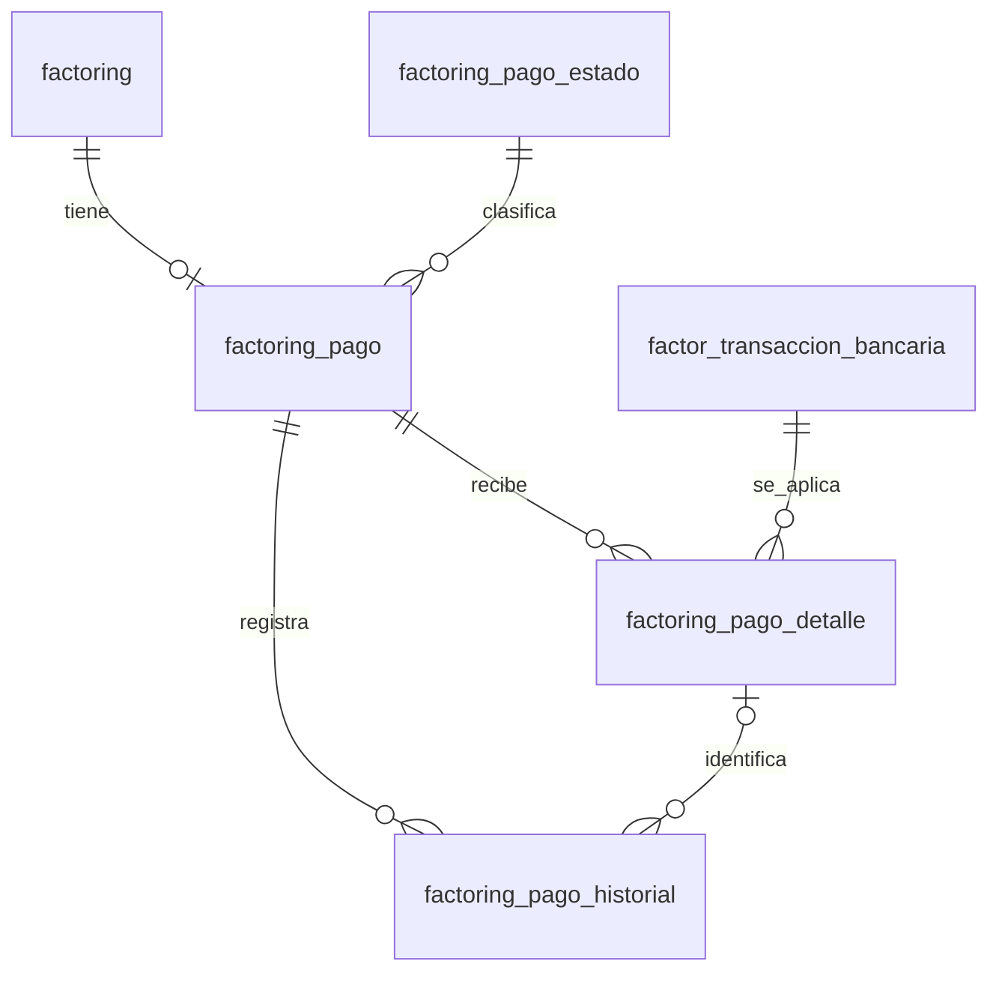

# Propuesta: maestro y detalle de pagos de Factoring

Fecha: 16/10/2026. Estado actual: modelo Charlie 5 aceptado; DDL aplicado en desarrollo con actor 105 y backend/frontend implementados. Ver [implementación y evidencia actual](pagos-factoring/implementacion.md). La [revisión inicial](revision-transicion-pagos-factoring-20261016.md) comprobó tabla vacía en solo lectura; la aplicación posterior tuvo autorización expresa separada. Producción no fue consultada ni modificada.

## Criterio de diseño

Una operación tiene un maestro de pago. Cada detalle representa el importe de una transacción bancaria aplicado a esa operación. La misma transacción puede aparecer en detalles de distintos maestros y una operación puede recibir varias transacciones. Así se resuelve la relación muchos a muchos sin otra tabla intermedia.

El importe acumulado se expone en el maestro como un resultado calculado: suma de sus detalles activos. No se persiste además un total editable. El estado funcional sí se persiste y lo modifica expresamente el usuario autorizado; registrar un abono no cambia automáticamente ese estado.

Decisión confirmada el 16/10/2026: se elige Charlie 5, con maestro separado, creado por el sistema cuando el usuario marca Inicio de operación. El maestro no tiene alta ni edición directa en la interfaz. El usuario gestiona los detalles y dispone de una acción específica «Cambiar estado de pago», expresamente confirmada, sin formulario de edición general del maestro. Ver el [ciclo de vida acordado](pagos-factoring/README.md#ciclo-de-vida-confirmado).

El alcance es por operación. Las facturas se obtienen de `factoring_factura`; no se reparte el abono entre facturas individuales. Si se requiere esa imputación en el futuro deberá diseñarse expresamente.

## Evidencia local y compatibilidad

- `prisma/ft_factoring/schema.prisma` contiene `factoring_pago` con operación, cuentas de empresa y factor, número bancario, fecha e importe. Actualmente representa abonos individuales, no un maestro único por operación.
- `factoring` ya identifica al factor, aceptante/pagador y moneda. Esos datos no deben copiarse a pagos.
- `factor_transaccion_bancaria` ya guarda cuenta del factor, número de operación, fecha bancaria DATE, signo y monto DECIMAL(20,2). La moneda se obtiene de su cuenta.
- `src/daos/factoring.Dao.ts` incluye `factoring_pagos` en consultas y `src/types/Prisma.types.ts` referencia esa relación. Adaptar la tabla exige revisar sus consumidores y contratos, aunque no se encontró un CRUD específico de pagos en la búsqueda de `src`.
- Se siguen las convenciones del modelo bancario vigente: PK interna unsigned, UUID público VARCHAR(50), códigos únicos, auditoría, estado lógico, versión para concurrencia y FKs restrictivas.

Se recomienda reutilizar el nombre `factoring_pago` para el maestro definitivo, mediante una transición controlada. El inventario posterior confirmó tabla vacía en desarrollo: allí no hay abonos que migrar, sujeto a verificarlo nuevamente antes del DDL. No interpretar posibles filas de otros destinos como maestros; cualquier migración de abonos históricos requiere autorización concreta y conciliación. El modelo bancario vigente excluía pagos de su primera etapa: esta propuesta es una ampliación separada, no una modificación retroactiva de ese alcance.

## Relaciones

La relación operación/maestro es 1 a 0..1 antes del inicio; al marcar Inicio de operación debe existir exactamente un maestro. Se conserva su identidad durante toda la vida de la operación, incluidos reintentos, retrocesos y reaperturas. El registro de cobros exige ese maestro: no se crea anticipadamente al registrar una operación ni implícitamente al intentar añadir un detalle. Las operaciones ya iniciadas antes de activar el módulo necesitan una regularización separada y autorizada, sin inventar pagos.

## Diccionario propuesto

Los nombres con `_id` son columnas físicas de MariaDB; Prisma las expondrá sin el prefijo mediante el flujo de introspección existente.

### `factoring_pago`: maestro por operación

| Campo | Tipo | Regla |
| --- | --- | --- |
| `_idfactoringpago` | INT UNSIGNED, PK, autoincremental | Identidad interna. |
| `factoringpagoid` | VARCHAR(50), único, UUID predeterminado | Identidad pública estable. |
| `code` | VARCHAR(255), único | Conservar el tamaño actual por compatibilidad; códigos nuevos generados por el servicio. |
| `_idfactoring` | INT UNSIGNED, FK, único | Solo un maestro por operación, incluso si se elimina lógicamente. |
| `_idfactoringpagoestado` | INT UNSIGNED, FK | Estado funcional seleccionado por el usuario; inicial PENDIENTE. |
| `version` | INT UNSIGNED, inicial 1 | Control de ediciones concurrentes. |

No contiene `monto_pagado`, saldo, pagador, moneda, cuenta bancaria, fecha bancaria ni número de transacción. La respuesta de consulta añade `monto_total_pagado = COALESCE(SUM(detalle.monto_aplicado activo), 0)` y la diferencia respecto del monto neto de la propuesta aceptada, según la regla confirmada más adelante. Agrupar el detalle antes de unir facturas para evitar multiplicar importes por el número de facturas.

### `factoring_pago_detalle`: aplicación de un abono

| Campo | Tipo | Regla |
| --- | --- | --- |
| `_idfactoringpagodetalle` | INT UNSIGNED, PK, autoincremental | Identidad interna. |
| `factoringpagodetalleid` | VARCHAR(50), único, UUID predeterminado | Identidad pública. |
| `code` | VARCHAR(20), único | Código del detalle. |
| `_idfactoringpago` | INT UNSIGNED, FK obligatoria | Maestro receptor. |
| `_idfactortransaccionbancaria` | INT UNSIGNED, FK obligatoria | Evidencia bancaria real; no número bancario libre. |
| `monto_aplicado` | DECIMAL(20,2), obligatorio | CHECK > 0; parte del movimiento asignada a esta operación. |
| `version` | INT UNSIGNED, inicial 1 | Control de concurrencia. |

Unicidad de `(_idfactoringpago, _idfactortransaccionbancaria)`, sin incluir `estado`: una aplicación vigente por par. Una corrección actualiza el mismo registro con historial; una reactivación justificada reutiliza el par anulado. Distintas transacciones del mismo día siguen siendo detalles distintos. La fecha efectiva y número bancario se consultan en la transacción, mientras que la fecha de registro del detalle es su auditoría.

No añadir `_idfactoring` al detalle: se obtiene del maestro. Tampoco copiar cuenta, moneda, descripción, fecha, comprobante o número de operación del movimiento. No exigir la cuenta de origen del pagador: un movimiento puede no identificarla con certeza. Si se necesita una cuenta empresarial verificada, deberá justificarse como información adicional, no inferirse del texto bancario.

### `factoring_pago_estado`: catálogo funcional

PK `_idfactoringpagoestado` INT UNSIGNED, UUID público `factoringpagoestadoid` VARCHAR(50), `code` VARCHAR(20) único, `nombre` y `alias` VARCHAR(50), `color` VARCHAR(50), más auditoría y estado lógico. Los IDs concretos se fijarán en el manifiesto de catálogo; las reglas usan códigos estables.

| Código | Nombre | Significado |
| --- | --- | --- |
| `PENDIENTE` | Pendiente de pago | El usuario aún no reconoce pagos aplicados. |
| `PARCIAL` | Pago parcial | Hay abonos y el usuario considera que queda importe por pagar. |
| `CANCELADO` | Cancelado totalmente | El usuario confirma que el pagador terminó de pagar. No significa anulación. |

El estado funcional es independiente de `estado`, que mantiene 1=ACTIVO y 2=ELIMINADO conforme al módulo bancario. No reutilizar `factoring_estado` ni el estado de liquidación: describen otros procesos.

### Auditoría común e historial

Maestro, detalle y catálogo incluyen `idusuariocrea` e `idusuariomod` INT obligatorios, sin asignar por defecto el usuario 1; `fechacrea` y `fechamod` TIMESTAMP(3), y `estado` TINYINT con CHECK IN (1,2). El backend exige actor autenticado y actualiza `fechamod` al modificar. Instantes de auditoría en UTC, visualizados en Lima; la fecha bancaria sigue siendo una fecha civil DATE.

`factoring_pago_historial` conserva los cambios del maestro y sus aplicaciones: PK `_idfactoringpagohistorial`, UUID `factoringpagohistorialid`, código, FK obligatoria `_idfactoringpago`, FK opcional `_idfactoringpagodetalle`, `evento` VARCHAR(50), `motivo` VARCHAR(500), valores anteriores y posteriores en JSON validado y auditoría. El historial permanece activo, es de solo inserción para el módulo y no se elimina desde la aplicación. Si identifica un detalle, el servicio verifica que pertenezca al maestro indicado. El contexto de maestro se conserva aquí para poder consultar todos sus eventos.

Registrar altas, correcciones, anulaciones, reactivaciones y cambios de estado. Motivo obligatorio para corregir, anular o reabrir; actor e historial se escriben en la misma transacción que el cambio. Los valores anteriores son evidencia de auditoría, no fuentes alternativas para calcular pagos.

## Integridad y comportamiento

1. FKs con ON DELETE/UPDATE RESTRICT; no borrar evidencia por cascada. Índices para estado funcional del maestro, transacción del detalle e historial por maestro/fecha. La restricción única del par cubre las consultas de detalle por maestro.
2. Solo aplicar movimientos activos con `signo = 1`, de una cuenta del mismo factor y con la misma moneda que la operación. El aceptante se obtiene de la operación; no asignar automáticamente por descripción, importe o referencia textual. El usuario debe verificar quién paga.
3. La suma de aplicaciones activas de una transacción, en todas las operaciones, no puede superar su `monto`. Puede quedar un remanente sin asignar. No usar `monto_neto` ni deducir comisiones como regla de cobro sin aprobación del negocio.
4. Validar y guardar con bloqueo de la fila bancaria y del maestro, orden estable de bloqueos y transacción corta. La versión del maestro aumenta también cuando cambian sus detalles. Un chequeo previo en interfaz no protege de asignaciones simultáneas.
5. Proteger también el módulo bancario: anular un movimiento o corregir su signo, cuenta, moneda, monto o fecha con aplicaciones activas requiere resolver primero sus aplicaciones de forma auditada. La FK por sí sola no evita estas inconsistencias. No excluir silenciosamente los pagos porque cambió el estado del movimiento.
6. El acumulado depende solo de detalles activos. Impedir eliminar lógicamente un maestro con aplicaciones activas. No permitir abonos nuevos en un maestro eliminado ni en una operación inhabilitada para cobro.
7. Alta y modificación de abonos no cambian el estado funcional automáticamente. El usuario puede conservar o modificar el estado aun cuando los importes sugieran otra situación. Las correcciones de detalles se auditan y refrescan la guía visual; no exigir una reapertura ni otro cambio de estado por diferencias de importe.
8. El monto acumulado y la diferencia no condicionan la selección de PENDIENTE, PARCIAL o CANCELADO. No exigir saldo cero, una tolerancia de céntimos ni un mínimo pagado para cambiar el estado. La guía visual no bloquea ni obliga a una confirmación adicional por la diferencia. Esta libertad no permite inventar abonos ni superar el importe disponible de una transacción bancaria.
9. No actualizar automáticamente liquidaciones, fecha de pago efectivo, saldos contables, fórmulas o estados actuales de la operación. La integración confirmada es crear el maestro al Inicio de operación; los abonos y el cierre manual no alteran por sí solos esos otros procesos.

Los CHECK y UNIQUE resuelven reglas de una fila o identidad; moneda, factor, sumas entre operaciones, pertenencia de eventos y transiciones requieren lógica transaccional. Usar aritmética decimal, nunca coma flotante para dinero.

## Ejemplo sintético

Una transacción bancaria de PEN 15,000 se distribuye así:

| Maestro / operación | Transacción | Importe aplicado |
| --- | --- | ---: |
| A | T1 | 10,000.00 |
| B | T1 | 5,000.00 |

La transacción T1 existe una sola vez. A acumula 10,000 y B acumula 5,000. Si B recibe después T2 por 2,000, tiene dos detalles y acumula 7,000. El usuario selecciona el estado de cada maestro según su situación; la transacción compartida no obliga a que ambas operaciones tengan el mismo estado.

## Regla de negocio confirmada por el usuario

El 16/10/2026 el usuario confirmó que la referencia es el **monto neto de la propuesta aceptada**, con diferencia informativa y cierre manual sin restricciones por importe, incluso cuando se pagan céntimos menos o más.

La fuente exacta es `factoring._idfactoringpropuestaaceptada → factoring_propuesta._idfactoringpropuesta → factoring_propuesta.monto_neto`. No usar `factoring.monto_neto`, la última propuesta por fecha ni una propuesta no aceptada como sustitutos. No copiar ese monto ni la FK de propuesta al maestro: se obtienen de la relación existente.

Valores calculados para la consulta y la pantalla, con precisión decimal y dos decimales:

- `monto_referencia`: monto neto de la propuesta aceptada.
- `monto_total_pagado`: suma de detalles activos, o cero si no hay abonos.
- `diferencia_pago = monto_referencia - monto_total_pagado`.
- Diferencia positiva: mostrar «Diferencia pendiente: [importe]».
- Diferencia cero: mostrar «Sin diferencia».
- Diferencia negativa: mostrar «Exceso pagado: [valor absoluto]».

Mostrar juntos referencia, acumulado, diferencia y estado elegido. Ejemplo sintético: referencia S/10,000.00 y pagos S/9,999.98 muestran diferencia pendiente S/0.02; el usuario puede seleccionar CANCELADO. Con pagos S/10,000.03, mostrar exceso S/0.03 y permitir igualmente CANCELADO. La diferencia sigue visible después del cierre, sin convertirla automáticamente en deuda exigible ni modificar reglas financieras existentes.

Si falta la propuesta aceptada, mostrar «Referencia no disponible» y diferencia no disponible, sin inventar cero ni usar otro monto. Esto tampoco impide seleccionar un estado. Un cambio autorizado de propuesta aceptada refresca la referencia y diferencia sin cambiar pagos ni estado; su trazabilidad corresponde al flujo existente de propuestas. No introducir una tolerancia numérica porque el usuario no la requiere para decidir el cierre.

## Secuencia de transición y estado

1. Completado para desarrollo: referencia y cierre manual confirmados; datos y consumidores revisados en modo lectura. Consultar el informe de transición enlazado al inicio y repetir la guarda de tabla vacía antes de aplicar.
2. Preparación completada para revisión: [SQL, manifiesto y límites](pagos-factoring/README.md), con guarda temporal de vacío y sin carga de catálogo. Validación real del DDL, compatibilidad de contratos y recuperación pendientes antes de aplicar.
3. Completado: autorización concreta de DDL y catálogo con actor 105; `db:ddl` en preview y aplicación con huellas, verificación y prisma-sync contra ese mismo destino. Sin migración de abonos.
4. Conservar las identidades y trazabilidad de abonos históricos mediante una correspondencia explícita. No fusionar maestros sin revisar sus UUID públicos ni vincular transacciones automáticamente por número bancario. Los abonos sin evidencia cierta quedan pendientes de conciliación; no fabricar movimientos ni declarar finalizada la migración.
5. Implementar API y pantalla con estado manual, acumulado calculado, diferencia informativa y aplicación compartida. Seleccionar comprobaciones con backend-validation y las instrucciones de los proyectos afectados; cubrir repartos, concurrencia, corrección bancaria, permisos, referencia de propuesta aceptada y cierre con diferencias positivas o negativas, con MariaDB desechable cuando corresponda.

## Revisión realizada

Revisión inicial documental del esquema local, diseño bancario vigente y referencias de pagos en código. La revisión posterior consultó desarrollo en solo lectura y añadió un revisor de agregados, sin cambios de código de aplicación, schema, DDL, migración, compilación ni pruebas de aplicación. La evidencia y límites están en el informe de transición; producción continúa sin verificar. Esta propuesta reemplaza, para este nuevo alcance, la sugerencia inicial de añadir una tabla puente adicional entre abonos y movimientos: el propio detalle es la aplicación.
